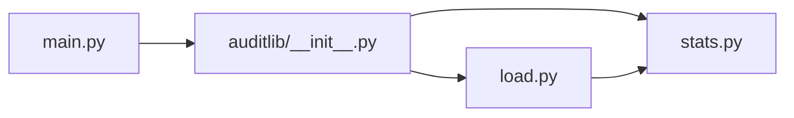

# Python Packages, Project Structure, and Type Hints

> A training script that loads data, scores it, and prints a report is easier to test when those three jobs live in different modules.

**Type:** Build
**Languages:** Python
**Prerequisites:** Phase 0, Lessons 06 (Python Environments) and 13 (Python for AI Engineering)
**Time:** ~50 minutes

## Learning Objectives

- Explain the difference between a module and a package.
- Split a program into modules that each have one responsibility.
- Export a small public interface from `__init__.py`.
- Keep helper functions out of that interface.
- Annotate functions and dataclasses with the types callers can rely on.
- Call calculation functions with records, and keep file reading in a separate module.
- Import the package, and the command-line module, without running the demo.

## The Problem

Lesson 13 put a loader, a split, and the vector math in one `main.py`. That file is the right size for a first toolkit. It gets in the way as soon as you want to check the math without creating a file, or to read a CSV without running the demo.

A later test lesson, and the API lessons after this phase, both need the same split. The test should call `summarize` with a list it built in memory. The program that a person runs should be a thin `main.py` that calls the library and prints. Importing the library must not print, and it must not require a CSV to exist.

## The Concept

A module is one `.py` file. A package is a directory of modules that Python can import as one name. The marker is `__init__.py`. Importing `auditlib` runs that file. Importing `auditlib.stats` runs `stats.py` and does not run `main.py`.



`load.py` may import `Record` from `stats.py`. `stats.py` does not import `load.py`. The arrow points from the file reader toward the calculations, so a test can build `Record` values and never open a file.

Names that start with `_` are for the module that defines them. `__init__.py` lists the names other code should import. Callers write `from auditlib import load_records, summarize`. They do not import `_row_to_record`.

Type annotations document that contract. Python does not check them when the function runs. They still tell a reader, and a later test, that `summarize` accepts a sequence of `Record` and returns a `Summary`.

`main.py` ends with the guard from lesson 13:

```python
if __name__ == "__main__":
    main()
```

`python3 main.py` sets `__name__` to `"__main__"` and runs the demo. `import main` from a test sets `__name__` to `"main"` and stops before `main()`.

## Build It

The package lives in `code/auditlib/`. The demo lives in `code/main.py`. Run the commands from the repository root, the directory that contains `README.md`.

### Step 1: The records and the summary

`stats.py` defines the two dataclasses and the only calculation. `summarize([])` returns a summary with `count` 0 and `mean_score` None. It does not treat an empty list as an error. A missing file is a different problem, and the loader reports it.

```python
from dataclasses import dataclass
from collections.abc import Sequence


@dataclass(frozen=True)
class Record:
    text: str
    label: int
    score: float


@dataclass(frozen=True)
class Summary:
    count: int
    label_counts: dict[int, int]
    mean_score: float | None


def summarize(records: Sequence[Record]) -> Summary:
    if not records:
        return Summary(count=0, label_counts={}, mean_score=None)
    label_counts: dict[int, int] = {}
    total = 0.0
    for record in records:
        label_counts[record.label] = label_counts.get(record.label, 0) + 1
        total += record.score
    return Summary(count=len(records), label_counts=label_counts, mean_score=total / len(records))
```

`frozen=True` matters for the same reason lesson 13 used it. Two names cannot change one record after it is built, so a summary cannot drift because a caller edited a row.

### Step 2: The CSV loader

`load.py` owns the file. Required columns are `text`, `label`, and `score`. A file that has the header and no data rows returns `[]`. A file with no header, a missing column, a blank field, or a score that is not a finite number raises `ValueError`. The message includes the line number, counting the header as line 1. A path that does not exist raises `FileNotFoundError` from `Path.open`.

```python
def _parse_score(raw: str | None, line_no: int) -> float:
    if raw is None or raw.strip() == "":
        raise ValueError(f"line {line_no}: score is missing")
    try:
        score = float(raw.strip())
    except ValueError:
        raise ValueError(
            f"line {line_no}: score must be a number, got {raw.strip()!r}"
        ) from None
    if score != score or score in (float("inf"), float("-inf")):
        raise ValueError(f"line {line_no}: score must be finite, got {raw.strip()!r}")
    return score
```

`from None` is the same choice as lesson 13. The message replaces the `float()` traceback, because the useful fact is the line number.

### Step 3: The public interface

```python
from .stats import Record, Summary, summarize
from .load import load_records

__all__ = ["Record", "Summary", "load_records", "summarize"]
```

The leading dots are package-relative imports. They work both when you run the demo as a script and when a test imports `auditlib`. `__init__.py` imports `stats` before `load`, because `load.py` needs `Record` to exist first.

### Step 4: The demo

`main.py` writes three rows into a temporary CSV, loads them, summarizes them, and prints four lines. The temporary directory disappears when the `with` block ends.

```bash
python3 phases/00-setup-and-tooling/14-python-packages-and-types/code/main.py
```

```text
Python packages and type hints
records  3
labels   0: 1, 1: 2
mean     0.566667
```

The mean is `(0.9 + 0.2 + 0.6) / 3`.

Check that an import stays quiet:

```bash
python3 -c "import main" 
```

Run that command from `code/`. It prints nothing and exits 0.

## Use It

The standard library already draws this line. `csv` reads rows. `statistics.mean` averages numbers you pass in. Neither module runs a program when you import it.

Later lessons in this phase will test `summarize` and `load_records` with `unittest`. A backend lesson will put the HTTP call in one module and the request builder in another, for the same reason the CSV reader is not inside `summarize`.

## Ship It

`outputs/skill-package-boundary.md` is a review checklist. Give it a small Python project. It asks whether calculations import the file loader, whether `__init__.py` exports helpers, and whether `import` of the library runs the demo.

## Exercises

1. Run `main.py`. Confirm the four printed lines, including the mean `0.566667`.
2. Add a fourth data row whose score is `high`. Run the loader on that file. The error names line 5, because the header is line 1.
3. In a Python prompt, build two `Record` values and call `summarize` without creating a file. The count is 2, and no CSV path appears in the call.
4. Add `positive_rate(records: Sequence[Record]) -> float` to `stats.py`. It is the fraction of records whose label is `1`. An empty sequence raises `ValueError`. Export it from `__init__.py` and cover it with a test. On the three-row sample the rate is `2/3`.

### Hints

**Exercise 1.** Run the command in Step 4 from the repository root. A mean of `0.566667` is the six-digit rendering of `1.7 / 3`.

**Exercise 2.** Copy `SAMPLE` from `main.py`, append one row, and write it under a temporary path. `load_records` raises `ValueError` before `summarize` runs.

**Exercise 3.** `from auditlib import Record, summarize` is enough. If the call asks for a path, the function is still the loader.

**Exercise 4.** `sum(record.label == 1 for record in records) / len(records)` is the rate. Check `not records` before the division. Add the name to `__all__`.

## Expected results

The lesson is done when all of these are true:

- `python3 main.py` prints the four-line sample summary and exits 0.
- `summarize` on the three sample records returns count 3, label counts `{0: 1, 1: 2}`, and mean `1.7 / 3`.
- `summarize([])` returns count 0 and `mean_score is None`.
- A header-only CSV loads as `[]`.
- A missing `score` column, a non-numeric score, and a missing file each raise, and the score error includes the line number.
- `from auditlib import summarize` does not expose `_row_to_record`.
- `import main` prints nothing.

## Common mistakes

- Putting `open` or `csv` inside `stats.py`. The summary then needs a disk, and the empty-list test is no longer a pure call.
- Exporting `_row_to_record` from `__init__.py`. Callers start to depend on a parser that is free to change.
- Forgetting `if __name__ == "__main__"`. A test that imports `main` then reruns the demo.
- Using `except:` with no type. It also catches `KeyboardInterrupt`, which lesson 13 already warned about. Catch `ValueError` around `int()` and `float()`, and let `FileNotFoundError` propagate.
- Writing `label_counts: dict[int, int] = {}` as a default argument. This lesson builds that dict inside `summarize`, so each call gets its own dict. A default dict would be shared, which is the mutable-default bug from lesson 13.

## Summary

`auditlib.stats` calculates. `auditlib.load` reads CSV. `__init__.py` exports four names. `main.py` is the only place the demo runs, and only when you execute that file.

## What this prepares you for

The next lessons in this phase test this split. A calculation test passes records in memory. A loader test uses a temporary CSV. Neither test needs a network, a key, or a GPU.

The API lesson after this stage makes the same cut. Building a request is a pure function of the messages and the model name. Sending the request is a different function. Tests can check the request without calling the provider, which is the same idea as calling `summarize` without a file.

## Key Terms

| Term | What people say | What it means |
|------|-----------------|---------------|
| Module | "A Python file" | One `.py` file that other code can import |
| Package | "A folder of modules" | A directory with `__init__.py`, imported as one name |
| Public interface | "The API" | The names `__init__.py` exports for callers outside the package |
| Internal helper | "A private function" | A name that starts with `_` and stays in its module |
| Annotation | "A type hint" | A declared parameter or return type that Python does not enforce at run time |
| Entry point | "The script" | The file a person runs. Importing it must not run that program |

## Further Reading

- [The Python Tutorial: Modules](https://docs.python.org/3/tutorial/modules.html): modules, packages, `__init__.py`, and `__name__`.
- [dataclasses](https://docs.python.org/3/library/dataclasses.html): `frozen` and field types.
- [csv](https://docs.python.org/3/library/csv.html): `DictReader` and `newline=""`.
- [PEP 484](https://peps.python.org/pep-0484/): what annotations mean, and that they are not checked at run time.
