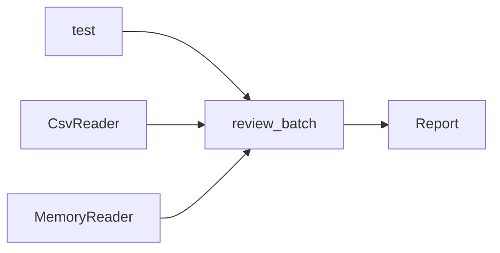

# Testing with Fakes and Temporary Files

> A check you can run on a list is a check you can run without a CSV, a network, or a key.

**Type:** Build
**Languages:** Python
**Prerequisites:** Phase 0, Lesson 14 (Python Packages, Project Structure, and Type Hints)
**Time:** ~60 minutes

## Learning Objectives

- Write `unittest` tests that assert a known result, an empty input, and a failure.
- Use `setUp` and `tearDown` when several tests share a directory.
- Give file tests their own `tempfile.TemporaryDirectory`.
- Replace the clock and an environment variable with `unittest.mock.patch`.
- Pass records through a `read` method so the summary does not open files.
- Feed that method from a CSV reader and from an in-memory fake.
- Keep every test deterministic: no network, no credentials, no sleeps, no machine paths.

## The Problem

Lesson 14 split `summarize` from `load_records`. The tests in that lesson already call the calculation with records built in memory. This lesson makes that split the thing you test on purpose.

A review batch has two questions. Did these rows arrive? Are the scores legal, and what is their mean? The second question does not care whether the rows came from `reviews.csv`, a temporary file, or a list the test typed out. If the check opens the file itself, every test needs a disk, and a bad path looks like a bad score.

The graded tests in this course use `unittest` from the standard library. Pytest is a popular alternative. This lesson names the matching pytest ideas and does not import pytest.

## The Concept

A test names an input and the result that input must produce. It does not pass because a function ran. It passes because the report's count, mean, and date match the values you calculated by hand.

Test the behavior a caller can see. The caller of `review_batch` sees a `Report` or an exception. The caller does not see whether the counts were stored in a dict or a list. A test that reads the source and looks for the word `open` is checking the implementation. A test that replaces `open` with a function that raises, then still gets a report, is checking behavior: this call did not need a file.



`review_batch` calls `source.read()`. `CsvReader.read` opens a CSV. `MemoryReader.read` returns the list it was given. A class written inside a test works too, if it has `read`. The batch never asks which class it received.

`setUp` runs before each test in that class. `tearDown` runs afterward, including when the test fails. Use them for a temporary directory several tests share. A test that needs no files does not need either method.

| This lesson | Pytest name for the same idea |
|-------------|-------------------------------|
| `setUp` and `tearDown` | A fixture that creates a value and cleans it up |
| `tempfile.TemporaryDirectory` | The `tmp_path` fixture |
| `unittest.mock.patch` and `patch.dict` | The `monkeypatch` fixture |

Pytest is optional reading. Nothing in `code/` imports it.

## Build It

The package is `code/reviewcheck/`. Run the commands from the repository root unless a command says to use `code/`.

### Step 1: The check

`review_batch` reads records, rejects a label other than 0 or 1, and rejects a score outside 0 to 1. An empty batch is valid: the mean and the accepted rate are `None`. The date comes from `clock()` when you pass one, and from `datetime.now` only when you do not.

```python
report = review_batch(source, clock=lambda: datetime(2026, 1, 2, tzinfo=timezone.utc))
```

A clock with no timezone raises `ValueError`. The demo passes a fixed clock, so the printed date does not change between runs.

### Step 2: Two readers

`CsvReader` owns the file. A header and no data rows returns `[]`. A missing column, a blank field, or a score that is not a number raises `ValueError` and includes the line number. A missing path raises `FileNotFoundError`.

`MemoryReader` stores a list. `path_from_env` reads `REVIEW_CSV` and raises `ValueError` when that variable is missing or blank. The batch does not call `path_from_env`. The program, or a test, does.

### Step 3: Run the demo

```bash
python3 phases/00-setup-and-tooling/15-testing-and-fakes/code/main.py
```

```text
Testing with fakes
records   3
mean      0.566667
accepted  0.666667
checked   2026-01-02
```

The mean is `(0.9 + 0.2 + 0.6) / 3`. Two of the three labels are `1`, so the accepted rate is `2/3`. The demo writes the CSV inside a temporary directory and deletes that directory before it prints.

From `code/`, this import prints nothing:

```bash
python3 -c "import main"
```

### Step 4: The tests

From `code/`:

```bash
python3 -m unittest discover tests -v
```

`FileTests.setUp` creates a temporary directory. `tearDown` deletes it. One test writes the sample CSV there and compares `CsvReader` with `MemoryReader` on the same three records. Another writes a file that has no `score` column. A third sets `REVIEW_CSV` with `patch.dict` for the duration of the `with` block, then the variable is restored.

`BatchTests` never creates a file. One test patches `reviewcheck.report.datetime` so a call that omits `clock` still returns `2026-01-02`. Another patches `open` so it raises. The memory-reader call still returns a count of 3. That is the proof the check does not read a file.

## Use It

The same boundary shows up in the API lessons. A function that builds a request from messages can be tested with a dict. A second function sends the request. Tests of the first function do not need a key or a network. `MemoryReader` is that dict. `CsvReader` is the sender's stand-in for this lesson, limited to a local file.

## Ship It

`outputs/skill-testing-boundary.md` reviews a test file. It asks whether each test asserts a value, whether a file test cleans up its directory, and whether a failing network call would fail the test.

## Exercises

1. Run `main.py` and confirm the five printed lines, including `checked   2026-01-02`.
2. Call `review_batch(MemoryReader([Record("too high", 1, 1.4)]), clock=...)`. The error names `record 1`.
3. Add a test in `FileTests` that writes only the header `text,label,score` and asserts the report count is 0. `setUp` already made the directory.
4. Add `label_rate(records, label)` in `report.py`. It returns the fraction of rows with that label, and it raises `ValueError` on an empty list. Test it with `MemoryReader` and without a file. On the sample, the rate for label `1` is `2/3`.

### Hints

**Exercise 1.** Run the Step 3 command from the repository root. The date stays `2026-01-02` because `FIXED_CLOCK` does not read the system clock.

**Exercise 2.** Import `MemoryReader`, `Record`, and `review_batch`. The `ValueError` happens inside `review_batch`, before a mean is computed.

**Exercise 3.** `path = self.directory / "empty.csv"` then `path.write_text("text,label,score\n", encoding="utf-8")`. `CsvReader(path).read()` returns `[]`, and the report count is 0.

**Exercise 4.** Divide the count of matching labels by `len(records)` after you reject an empty sequence. Do not open a path inside the function.

## Expected results

The lesson is done when all of these are true:

- `python3 main.py` prints the five-line sample and exits 0.
- The three sample records produce count 3, mean `1.7 / 3`, accepted rate `2 / 3`, and the date you passed in.
- An empty reader produces count 0 and a mean of `None`.
- A score of `1.4` raises `ValueError` and the message contains `record 1`.
- A temporary CSV and `MemoryReader` produce equal reports for the sample.
- A file with no `score` column raises `ValueError`.
- With `open` patched to raise, the memory-reader batch still returns count 3.
- `REVIEW_CSV` set inside `patch.dict` is visible only inside that block.

## Common mistakes

- Opening the CSV inside `review_batch`. The memory-reader test then fails, and so does the test that patches `open`.
- Asserting that a helper was called, or that the source contains a string. Those tests stay green when the mean is wrong.
- Using a path such as `C:\Users\me\reviews.csv`. The next machine does not have that file. Use `TemporaryDirectory`.
- Forgetting `tearDown`. A failed test then leaves a directory behind, and the next run is harder to reason about.
- Calling `datetime.now()` inside the test and comparing it to the report. The date can change at midnight. Pass a fixed `clock`, or patch `datetime`.
- Letting a test call a real API "just to see." A missing key or a timeout makes the test fail for a reason that is not the code.

## Summary

`review_batch` checks records from `source.read()`. `CsvReader` and `MemoryReader` are two ways to supply that method. `unittest` asserts the report, uses a temporary directory for files, and uses `patch` for the clock and `REVIEW_CSV`.

## What this prepares you for

The next lesson in this phase loads configuration from the environment and logs decisions. `patch.dict` is how you test a missing variable without changing the shell you are working in. The API lessons reuse the reader split: build the request in a pure function, and test it with a fake instead of a live call.

## Key Terms

| Term | What people say | What it means |
|------|-----------------|---------------|
| Unit test | "A check" | Code that calls one behavior and asserts the result |
| Boundary | "The empty case" | An input at the edge, such as no records |
| Fake | "An in-memory stand-in" | An object with the real method and none of the real I/O |
| Patch | "A mock" | A temporary replacement of a function, class, or environment variable |
| Isolation | "A clean run" | Each test makes its own files and restores what it replaced |
| Fixture | "Pytest setup" | The pytest name for shared setup. Here that job is `setUp` |

## Further Reading

- [unittest](https://docs.python.org/3/library/unittest.html): `TestCase`, `setUp`, `tearDown`, and assertions.
- [tempfile](https://docs.python.org/3/library/tempfile.html): `TemporaryDirectory`.
- [unittest.mock](https://docs.python.org/3/library/unittest.mock.html): `patch` and `patch.dict`.
- [pytest fixtures](https://docs.pytest.org/en/stable/how-to/fixtures.html): the optional names `tmp_path` and `monkeypatch` correspond to.
