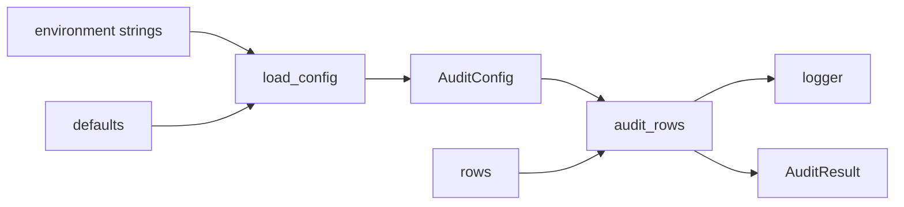

# Configuration, Logging, and Checks

> A setting is a string until you parse it, and a log is safe only when it leaves the secret out.

**Type:** Build
**Languages:** Python
**Prerequisites:** Phase 0, Lesson 15 (Testing with Fakes and Temporary Files)
**Time:** ~45 minutes

## Learning Objectives

- Define defaults, then override them from environment variables.
- Parse those strings and raise `ConfigError` with a message that names the rule.
- Log with the standard-library `logging` module at a chosen level.
- Keep secrets, tokens, and row text out of log lines.
- Let an expected audit failure propagate, and do not use a bare `except`.
- Test defaults, overrides, invalid values, and log text with `unittest` and `patch.dict`.

## The Problem

Lesson 6 gave each project its own packages. That choice is about what is installed. This lesson is about how one run is configured. The same program can audit a small sample or demand a thousand rows. Those numbers should not be hard-coded into `audit_rows`, and they should not require a new dependency.

Environment variables are the usual place for that kind of setting. They arrive as strings. The variable `AUDIT_MIN_ROWS=10` is the characters `1` and `0`, not the integer 10. Comparing that string with a number raises `TypeError`. Calling `int` on the word `ten` raises `ValueError`. A useful program turns those failures into one error type whose message says which variable broke and which rule it broke.

The audit also has to say what it did. `print` is fine for a final line a person reads. It is a poor record of a decision, because it has no level and it is easy to print a token by accident. `logging` has levels, and the message you pass is the whole of what gets recorded.

## The Concept

`load_config` reads three names and ignores everything else.

| Variable | Default when missing or blank | Rule |
|----------|-------------------------------|------|
| `AUDIT_MIN_ROWS` | `1` | An integer greater than or equal to 1 |
| `AUDIT_LABEL_COLUMN` | `label` | A Python identifier, such as `label` |
| `AUDIT_LOG_LEVEL` | `INFO` | `DEBUG`, `INFO`, `WARNING`, or `ERROR` |

A blank or whitespace-only value uses the default. The word `ten`, the number `0`, and the level `verbose` do not. Each of those raises `ConfigError`. The message names the variable and the rule. It does not repeat an API token that happens to sit in a different variable, and it does not dump `os.environ`.

`audit_rows` receives the config object, not the environment. If the batch is shorter than `min_rows`, or a row lacks the label column, it raises `AuditError`. That is an expected application failure: the settings were valid and the data was not. A bug, such as passing a config of the wrong type, is a programming error. Let that traceback surface. Do not write `except:` and do not write `except Exception` merely to keep going.



Log levels go from quieter to louder: `DEBUG`, `INFO`, `WARNING`, `ERROR`. A logger set to `ERROR` records `ERROR` and hides `INFO`. A successful audit logs an info line with the row count, the column name, and `min_rows`. A rejected batch logs a warning with those same facts. Neither line includes row text or any variable the loader did not ask for.

Optional tools such as Ruff or mypy can check style and annotations on your machine. They are not imported here, and the lesson runs without them.

## Build It

The package is `code/datasetaudit/`. Run the commands in this section from `code/`.

### Step 1: Load the settings

`AuditConfig` is a frozen dataclass with the three defaults. `load_config()` with no argument reads `os.environ`. `load_config({})` reads an empty mapping, which is how the demo stays stable if your shell already has these variables set. Tests that want the process environment use `patch.dict`.

```python
from datasetaudit import load_config

config = load_config({"AUDIT_MIN_ROWS": "4", "AUDIT_LABEL_COLUMN": "topic"})
```

`config.min_rows` is the integer `4`, and `config.log_level` stays `"INFO"`.

### Step 2: Check the rows

`audit_rows` counts labels when every row has `config.label_column` and the batch is long enough. Pass a logger when you want to capture the text in a test. The demo builds one with `configure_logging`.

```python
from datasetaudit import AuditConfig, audit_rows

config = AuditConfig(min_rows=1, label_column="label", log_level="INFO")
result = audit_rows(rows, config, logger)
```

### Step 3: Run the demo

```bash
python main.py
```

The demo sends the log to stdout so the two lines stay in this order. The first line comes from the logger:

```text
INFO datasetaudit.demo: audit kept rows=3 label_column=label min_rows=1
```

The program then prints one summary line:

```text
Dataset audit kept 3 rows
```

The three sample rows are in memory. Two of them have the label `1`, and one has the label `0`. The demo does not read a file, a key, or the network.

From `code/`, this import prints nothing and does not log:

```bash
python -c "import main"
```

### Step 4: The tests

```bash
python -m unittest discover tests -v
```

`patch.dict(os.environ, {...}, clear=True)` installs the mapping for the body of the `with` block and restores the previous environment afterward. One test leaves the three audit variables unset and expects the defaults. Another sets `AUDIT_MIN_ROWS` to `4`, the label to `topic`, and the level to `warning`, and expects `WARNING` after parsing. A third sets `AUDIT_MIN_ROWS` to `ten` and also sets `AUDIT_API_TOKEN`. `ConfigError` names `AUDIT_MIN_ROWS`, and the message does not contain the token. A fourth sets `AUDIT_MIN_ROWS` to `0` and expects the lower-bound message.

The audit tests pass `AuditConfig` straight in. A batch of two rows with `min_rows` 3 raises `AuditError`, and the warning names `min_rows=3` without the row text. A batch of three rows with `min_rows` 2 returns counts `{"1": 2, "0": 1}`. A successful audit whose environment contains a token does not write that token. A logger set to `ERROR` does not emit the info line.

## Use It

Ruff and mypy are optional local checks. From `code/`, if you already have them installed:

```bash
ruff check datasetaudit
mypy datasetaudit
```

If either command is not found, skip it. Do not add them to this lesson, and do not import them from `main.py` or the tests. The graded checks are `python main.py` and `unittest`.

The same split shows up when a program grows. Load settings in one function. Pass the typed object into the function that does the work. Tests of the work then build an `AuditConfig` directly and never touch the shell.

## Ship It

`outputs/skill-config-and-logs.md` reviews a small configuration module. It asks whether defaults are explicit, whether environment strings are parsed, whether `ConfigError` avoids secrets, and whether a log line can leak a token.

## Exercises

1. From `code/`, run `python main.py` and confirm the stderr line and the stdout summary.
2. Call `load_config({"AUDIT_MIN_ROWS": "0"})` and confirm `ConfigError` says `at least 1`.
3. Call `audit_rows` with `min_rows` 4 and the three sample rows. Confirm `AuditError` and a warning that does not include `good film`.
4. Add a test that sets `AUDIT_LOG_LEVEL` to `verbose` with `patch.dict` and asserts `ConfigError`. After the block, that variable must be gone.

### Hints

**Exercise 1.** Run the Step 3 command from `code/`. The demo calls `load_config({})`, so a value already set in your shell does not change the sample.

**Exercise 2.** Import `load_config` and `ConfigError`. The integer `0` parses, then the lower bound fails. You do not need a row list for this call.

**Exercise 3.** Build `AuditConfig(min_rows=4, label_column="label", log_level="INFO")` and pass `main.SAMPLE_ROWS`. Capture a logger the way `capture_logger` does in the tests.

**Exercise 4.** `patch.dict(os.environ, {"AUDIT_LOG_LEVEL": "verbose"}, clear=True)` wraps `load_config()`. Assert that the message names `AUDIT_LOG_LEVEL`.

## Expected results

The lesson is done when all of these are true:

- `python main.py` from `code/` logs the kept line and prints `Dataset audit kept 3 rows`.
- `load_config({})` returns `min_rows` 1, label `label`, and level `INFO`.
- `AUDIT_MIN_ROWS=4` becomes the integer 4, and `warning` becomes `WARNING`.
- `AUDIT_MIN_ROWS=ten` raises `ConfigError`, and the message does not contain a token set beside it.
- `AUDIT_MIN_ROWS=0` raises `ConfigError` and the message says `at least 1`.
- Two rows with `min_rows` 3 raise `AuditError`. Three rows with `min_rows` 2 return a kept count of 3.
- A log from a successful audit does not contain `AUDIT_API_TOKEN` or its value.
- A logger at `ERROR` does not emit `audit kept`.

## Common mistakes

- Treating an environment value as an int. `"10" < 5` is a type error in Python 3. Parse it first.
- Echoing `os.environ` in an error or a log. One of those values is often a token.
- Using `except:` or `except Exception` and then returning a successful result. The caller cannot tell a bad batch from a bug.
- Logging the row dict. The text field is not a setting, and it does not belong in the record of the decision.
- Importing Ruff, mypy, or pytest into the graded modules. This lesson stays on the standard library.
- Calling `int(os.environ["AUDIT_MIN_ROWS"])` when the variable is unset. A missing variable is the default, not a crash. Read it with `.get`, and treat blank text as missing.

## Summary

`load_config` turns three environment strings into an `AuditConfig`, or raises `ConfigError` with the variable name and the rule. `audit_rows` uses that object, logs counts rather than secrets, and raises `AuditError` when the batch fails a check. `patch.dict` puts those variables in place for one test and puts them back afterward.

## What this prepares you for

A later checkpoint can load this config, read a CSV through the reader from Lesson 15, and stop when the row count is below `min_rows`. The API lessons reuse the same rule: parse settings up front, pass a typed object into the call, and keep tokens out of the log.

## Key Terms

| Term | What people say | What it means |
|------|-----------------|---------------|
| Default | "The usual value" | The setting used when the variable is missing or blank |
| Environment variable | "An env var" | A string the process receives from the shell |
| ConfigError | "Bad settings" | The dedicated error for a value that fails parsing or a rule |
| Log level | "How loud" | The threshold that decides which messages are emitted |
| Secret | "A token or a key" | A value that must never appear in a log or an error dump |
| Expected error | "A failed check" | `AuditError` for a bad batch. A bug is not this, and should not be swallowed |

## Further Reading

- [os.environ](https://docs.python.org/3/library/os.html#os.environ): the process environment, and why values are strings.
- [logging](https://docs.python.org/3/library/logging.html): levels, loggers, and handlers.
- [dataclasses](https://docs.python.org/3/library/dataclasses.html): a frozen dataclass as a small typed config.
- [unittest.mock](https://docs.python.org/3/library/unittest.mock.html#unittest.mock.patch.dict): `patch.dict` for one test.
