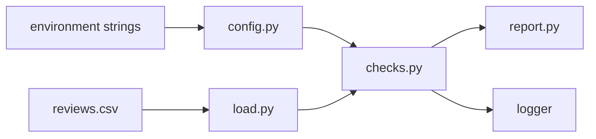

# Dataset Audit Checkpoint

> The same three rows are a passing audit, a missing column, or a batch that is too small, depending on which function you call.

**Type:** Build
**Languages:** Python
**Prerequisites:** Phase 0, Lesson 16 (Configuration, Logging, and Checks)
**Time:** ~70 minutes

## Learning Objectives

- Split CSV loading, label checks, the summary, configuration, and logging into separate modules.
- Load typed settings from defaults and environment variables, and raise `ConfigError` when they are invalid.
- Reject a missing label column and a label other than 0 or 1.
- Report the row count and the counts of labels 0 and 1, and log those counts without row text or secrets.
- Test the audit with a temporary CSV, an in-memory record list, and `patch.dict`.

## The Problem

Lessons 14, 15, and 16 each practiced one split. This checkpoint puts them in one program. A dataset audit has to read a CSV, reject a bad label, honor a minimum row count, and print a short summary. A single script can do that. It is hard to test, because a bad label, a short file, and a typo in `AUDIT_MIN_ROWS` all fail in the same function, and the test cannot tell them apart.

Lesson 6 isolated packages with a virtual environment. This lesson does not install anything. It isolates responsibilities inside one package so each failure has its own type. Passing this checkpoint means the pieces work together on a three-row file. It does not mean the program is ready for a production data pipeline.

## The Concept

`reviewaudit` has five modules. `main.py` is the only entry point, and importing it does not run the audit.

| Module | Owns | Does not own |
|--------|------|----------------|
| `config.py` | Defaults, environment parsing, `ConfigError` | Files and row counts |
| `load.py` | The CSV header, required columns, integer labels | Whether a label is 0 or 1 |
| `checks.py` | Minimum rows, labels 0 and 1, `CheckError` | Opening files |
| `report.py` | `Record`, `Summary`, and the printed lines | The environment |
| `logging_config.py` | One logger at the configured level | The text of each message |



`load_config` reads `AUDIT_MIN_ROWS`, `AUDIT_LABEL_COLUMN`, and `AUDIT_LOG_LEVEL`. A missing or blank value uses the default: minimum 1, column `label`, level `INFO`. The word `ten` and the number `0` raise `ConfigError`. The message names the variable and the rule. It does not copy the rest of the environment.

`load_csv` checks the header. A file whose header is `text,score` raises `SchemaError` because `label` is absent. A header and no data rows returns `[]`. A label of `2` is a legal integer, so the loader accepts it. `check_records` then raises `CheckError`, because a label must be 0 or 1. The same error type rejects a batch shorter than `min_rows`. With `AUDIT_MIN_ROWS=10000`, the three-row sample fails even though every label is legal.

`summarize([])` returns a count of 0 and a count of 0 for each label. That is the empty calculation. The audit does not accept it while the minimum is 1. `check_records` raises `CheckError` before it asks for a summary.

The success log names the row count and the two label counts. It does not name the film text, an API token, or the full environment. A warning for a rejected batch names the row count or the record index, not the text of the row.

## Build It

The package is `code/reviewaudit/`. The sample file is `code/fixtures/reviews.csv`. Run the commands in this section from `code/`.

### Step 1: Settings

```python
from reviewaudit import load_config

config = load_config({"AUDIT_MIN_ROWS": "3", "AUDIT_LABEL_COLUMN": "topic"})
```

`config.min_rows` is the integer 3. `config.log_level` stays `"INFO"`.

### Step 2: Load, check, and report

`load_csv` needs the label column from the config. `check_records` needs the whole config and a logger. `format_summary` turns the result into three lines.

```python
records = load_csv(path, config.label_column)
summary = check_records(records, config, logger)
print(format_summary(summary), end="")
```

A test that already has `Record` objects skips `load_csv` and calls `check_records` directly.

### Step 3: Run the demo

```bash
python main.py
```

The logger writes this line, then the program prints the summary:

```text
INFO reviewaudit.demo: audit kept rows=3 label_0=1 label_1=2 min_rows=1
rows      3
label 0   1
label 1   2
```

The sample has three rows. One label is `0` and two labels are `1`. The demo calls `load_config({})`, so a value already set in your shell does not change the run. It reads the checked-in fixture and does not use the network.

From `code/`, this import prints nothing and does not log:

```bash
python -c "import main"
```

### Step 4: The tests

```bash
python -m unittest discover tests -v
```

One test loads `fixtures/reviews.csv` and expects count 3, one zero, and two ones. Another writes that same text into a `TemporaryDirectory` and compares it with the in-memory records. A header of `text,score` raises `SchemaError` and the message contains `missing column label`. A record whose label is `2` raises `CheckError` and the message contains `got 2`. `patch.dict` sets `AUDIT_MIN_ROWS` to `10000` and a token the audit does not use. The check fails with `at least 10000`, and neither the error nor the log contains the token.

A header-only file loads as `[]`. `summarize` of that list is all zeros. `check_records` with the default config rejects it.

## Use It

Ruff and mypy are optional local checks. From `code/`, if you already have them installed:

```bash
ruff check reviewaudit
mypy reviewaudit
```

If either command is not found, skip it. Do not import them, and do not add them to this lesson. The graded commands are `python main.py` and `unittest`.

The split is what you keep when a later lesson adds a real dataset. The loader can grow a new column without changing the arithmetic. The check can grow a new rule without opening a file. The tests for the arithmetic never need a disk.

## Ship It

`outputs/skill-dataset-audit.md` reviews a small audit package. It asks whether loading, checks, the summary, and configuration are separate, and whether a log line can leak a row or a token.

## Exercises

1. From `code/`, run `python main.py` and confirm the log line and the three summary lines.
2. Write a temporary CSV with one label of `2`. Confirm `CheckError` names `got 2` and the log does not contain the row text.
3. Call `load_config({"AUDIT_MIN_ROWS": "10000"})` and pass the three sample records to `check_records`. Confirm the error says `at least 10000`.
4. Load a file whose only line is `text,label`. Confirm `summarize` of that empty list is all zeros, and `check_records` rejects it.

### Hints

**Exercise 1.** Run the Step 3 command from `code/`. The fixture path is next to `main.py`, under `fixtures/`.

**Exercise 2.** `Record("bad film", 2)` is enough. You do not need a file. Pass a logger that writes to a `StringIO`, and assert the film title is absent.

**Exercise 3.** Build the config from a mapping, not from the shell. The three records are valid labels, and the failure is the minimum.

**Exercise 4.** `load_csv` returns `[]` for a header and no data. `summarize([])` does not raise. The default `AuditConfig` has `min_rows` 1, so `check_records` does.

## Expected results

The lesson is done when all of these are true:

- `python main.py` from `code/` logs the kept line and prints `rows` 3, `label 0` 1, and `label 1` 2.
- `import main` prints nothing.
- The checked-in fixture and the same three `Record` objects produce the same summary.
- A CSV without a `label` column raises `SchemaError`, and the message names that column.
- A label of `2` raises `CheckError`, and the message contains `got 2`.
- `AUDIT_MIN_ROWS=10000` raises `CheckError` with `at least 10000` and `got 3`.
- `load_config({})` returns minimum 1, column `label`, and level `INFO`.
- A header-only file loads as an empty list. `summarize` of that list is all zeros. The audit rejects it.
- A log from the sample does not contain `good film` or a token left in the environment.

## Common mistakes

- Putting the file open, the label rule, and the count in one function. A test for label `2` then needs a CSV, and a test for the count needs a disk.
- Treating `AUDIT_MIN_ROWS=10000` as a schema problem. The file is well formed. The batch is too small for that setting.
- Logging `record.text` or `os.environ`. The row text and a token do not belong in the record of the decision.
- Using `except:` and printing the success summary anyway. The caller cannot tell a bad label from a finished audit.
- Calling `summarize` on a label of `2` and expecting a quiet count. The summary refuses a label outside 0 and 1. `check_records` is the function that reports which record failed.
- Editing `fixtures/reviews.csv` inside a test. Write the broken file in a `TemporaryDirectory`, or pass `Record` objects.

## Summary

`load_csv` turns a file into records or raises `SchemaError`. `check_records` applies `min_rows` and the binary label, logs the counts, and returns a `Summary`. `load_config` supplies those settings from defaults and environment strings. The three-row fixture passes. A missing column, a label of `2`, and a minimum of 10000 fail in different functions, with different error types.

## What this prepares you for

Later data lessons can reuse this split: parse settings, read rows, check a rule, then calculate. This checkpoint is the foundation for that habit. A larger dataset, a model, or a service would add new modules beside these, not a pile of new rules inside `main.py`.

## Key Terms

| Term | What people say | What it means |
|------|-----------------|---------------|
| Checkpoint | "The pieces together" | A lesson that combines earlier skills on one small program |
| SchemaError | "Bad file" | The header or a field cannot be read |
| CheckError | "Bad batch" | The rows were readable and failed a rule |
| ConfigError | "Bad setting" | An environment value failed parsing or a bound |
| Boundary | "The empty file" | A header and no rows: a zero summary, and an audit failure when the minimum is 1 |
| Isolation | "No shared file" | A test uses memory or a temporary directory, then leaves the fixture unchanged |

## Further Reading

- [csv](https://docs.python.org/3/library/csv.html): `DictReader` and header rows.
- [logging](https://docs.python.org/3/library/logging.html): levels and handlers.
- [unittest](https://docs.python.org/3/library/unittest.html): assertions and `assertRaises`.
- [tempfile](https://docs.python.org/3/library/tempfile.html): `TemporaryDirectory`.
- [unittest.mock](https://docs.python.org/3/library/unittest.mock.html#unittest.mock.patch.dict): `patch.dict` for one test.
